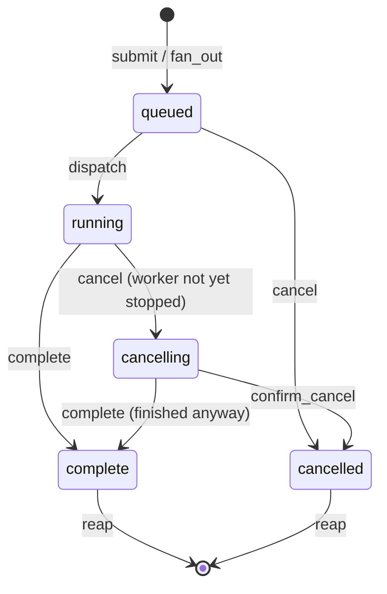
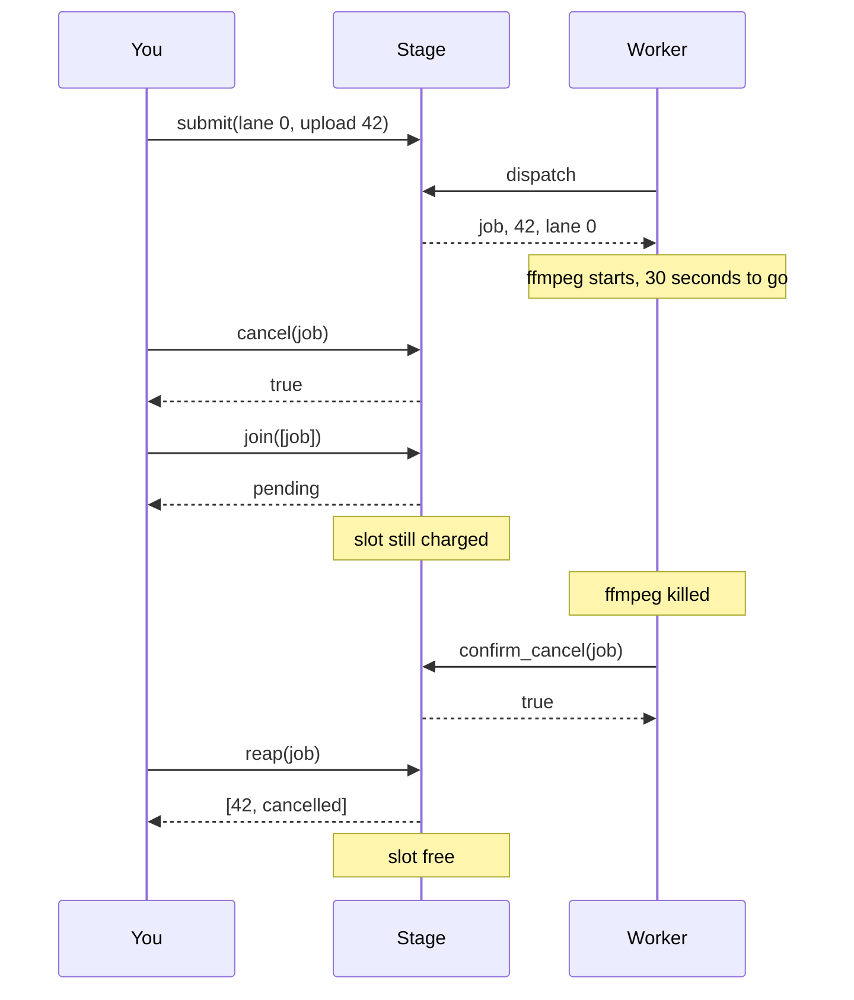

# PipelineMachines

> A job you cancelled is still on the ship until someone signs for it. 🛤️

A stage coordinator for Ruby. You submit work into one of four weighted lanes, pull it out in fair order, report what happened, and collect the receipt. Fan a job out across several lanes and join on all of them. The stage keeps count of every slot, including the ones holding work you told to stop but that hasn't stopped yet.

## Quick Start

```bash
gem 'pipeline_machines'
```

```ruby
# Four lanes: transcode, thumbnail, captions, notify. Thumbnails get double share.
stage = PipelineMachines::Stage.new([1, 2, 1, 1])

# One upload, three lanes at once.
jobs = stage.fan_out([0, 1, 2], upload.id)

# The worker loop. dispatch hands back [job, payload, lane].
while (job, payload, lane = stage.dispatch)
  run_lane(lane, payload)
  stage.complete(job)
end

stage.join(jobs)                     # => :ready
jobs.each { |job| stage.reap(job) }  # collect receipts, free the slots
```

## A Message to the Resistance

So you built the upload pipeline. A job comes in, you push three tasks onto a queue, three workers pick them up, the video gets transcoded, thumbnailed, and captioned. Then product asked for cancel.

You added a `cancelled` flag. Workers check it before starting. Great. Except the transcode worker checked it four seconds ago and is now thirty seconds into an ffmpeg call that doesn't care about your flag. The user sees "cancelled", uploads a replacement, and now two transcodes of the same video are fighting over one CPU. Meanwhile your concurrency limit says there's a free slot, because the cancelled job was removed from the queue the moment the flag flipped.

The queue was honest about what was *waiting*. It lied about what was *running*. A slot isn't free when you decide a job should stop. It's free when the job has actually stopped and you've collected the outcome.

This gem keeps that count. Queued work can be cancelled outright. Running work stays on the books until the worker confirms it quit, or finishes anyway. Nothing frees a slot except reaping the receipt.

## Chapter 1: Stardate 2025.186, the AMS Welsh

> **AMS Welsh**, NCC-4212, *Welsh*-class stage carrier.
> Freight is not gone merely because it left the waiting deck.

The carrier doesn't run any of the work. It holds the manifest: which berths are charged, which descriptors are on the waiting deck, which are on the work deck, and which outcomes are still unsigned. A berth stays charged until the receipt is collected. Not when the job is dispatched, not when it's cancelled. Collected.

Somewhere on the bridge, a junior officer proposes:

```ruby
def cancel(job)
  queue.delete(job)
  job.update(status: :cancelled)   # the worker will notice. probably.
end
```

"That," says the deck officer, "is how a berth gets charged twice."

## The Flight Plan

Every job is in exactly one of these states. Only reaping frees its slot.



And the upload that got cancelled mid-transcode:



## How the Deck Works

### Submit and dispatch

Lanes are numbered 0 to 3. Each lane has a weight you choose at construction. Dispatch walks the lanes in weighted round robin, first in first out within a lane.

```ruby
stage = PipelineMachines::Stage.new([1, 2, 1, 1])
stage.lanes      # => 4
stage.capacity   # => 64

stage.submit(0, 100)
stage.submit(0, 101)
stage.submit(1, 200)
stage.submit(1, 201)
stage.submit(2, 300)

job, payload, lane = stage.dispatch
[payload, lane]   # => [100, 0]
```

Lane 1 has weight 2, so it gets two turns per round. With the queue above, dispatch order is lane 0, lane 1, lane 1, lane 2, then lane 0 again. Payloads are Integers: ids, pointers into your own tables, whatever names the work. The stage never sees the work itself.

A lane that doesn't exist, or a full stage, returns `nil` from `submit`. It never raises for that.

### Fan out and join

One payload, several lanes, admitted atomically. Either every lane gets a job or none does.

```ruby
stage = PipelineMachines::Stage.new([1, 1, 1, 1])
jobs = stage.fan_out([3, 1], 9)
jobs.size             # => 2
stage.join(jobs)      # => :pending

2.times do
  job, = stage.dispatch
  stage.complete(job)
end
stage.join(jobs)      # => :ready
```

`join` answers for the whole group. `:ready` when every job completed, `:cancelled` when any was cancelled, `:pending` while any is still queued, running, or waiting on a cancel confirmation, and `:unknown` if any handle has been reaped or belongs to another stage. Lanes in a fan-out must be distinct, and asking for a lane that doesn't exist returns `nil` without admitting anything.

### Cancel, and what cancel actually means

Cancel a queued job and it's done. Terminal. Reap it whenever you like.

```ruby
stage = PipelineMachines::Stage.new([1, 1, 1, 1])
job = stage.submit(2, 77)

stage.cancel(job)     # => true
stage.join([job])     # => :cancelled
stage.reap(job)       # => [77, :cancelled]
stage.dispatch        # => nil, nothing left
```

Cancel a *running* job and you've only asked. The slot stays charged until the worker says it stopped.

```ruby
stage = PipelineMachines::Stage.new([1, 1, 1, 1])
stage.submit(0, 5)
job, = stage.dispatch

stage.cancel(job)           # => true, request noted
stage.reap(job)             # => nil, not terminal yet
stage.join([job])           # => :pending

stage.confirm_cancel(job)   # => true, worker has stopped
stage.reap(job)             # => [5, :cancelled]
```

If the worker finishes before it sees the request, `complete` wins and the cancel is moot:

```ruby
stage = PipelineMachines::Stage.new([1, 1, 1, 1])
stage.submit(0, 1)
job, = stage.dispatch

stage.cancel(job)           # => true
stage.complete(job)         # => true, it finished anyway
stage.confirm_cancel(job)   # => false, nothing to confirm
stage.reap(job)             # => [1, :complete]
```

### Reap, or the slot never comes back

The stage holds 64 jobs. Not 64 queued, not 64 running. 64 *unreaped*. A completed job you never reap is a slot you never get back.

```ruby
stage = PipelineMachines::Stage.new([1, 1, 1, 1])
jobs = 64.times.map { |i| stage.submit(0, i) }
stage.submit(0, 65)         # => nil, full

job, = stage.dispatch
stage.complete(job)
stage.submit(0, 65)         # => nil, still full. complete isn't reap.

stage.reap(job)             # => [0, :complete]
stage.submit(0, 65)         # now admitted
```

`reap` only returns for terminal jobs: `[payload, :complete]` or `[payload, :cancelled]`. Anything else is `nil`. After reaping, the handle is dead. Every call with it returns `false` or `nil`, and `join` reports `:unknown`.

### Drain

Shutting down a worker pool means two things: stop taking work, and know when the last job is gone.

```ruby
stage = PipelineMachines::Stage.new([1, 1, 1, 1])
job = stage.submit(0, 5)

stage.begin_drain
stage.submit(0, 6)          # => nil, closed
stage.drained?              # => false, one job still charged

work, = stage.dispatch      # draining still dispatches what's queued
stage.complete(work)
stage.drained?              # => false, completed but not reaped
stage.reap(job)
stage.drained?              # => true
```

## The Rules of the Carrier

- **Four lanes, sixty-four slots.** Weights are an Array of exactly four Integers in `1..2**32-1`. Anything else raises `TypeError` or `ArgumentError`.
- **Lanes and payloads are Integers** in `0..2**64-1`. Floats and strings raise `TypeError`. Negative or too large raises `RangeError`.
- **Bad lanes and full stages return `nil`.** Only malformed input raises.
- **Handles belong to one stage.** A job from another stage, or one already reaped, mutates nothing: `cancel`, `complete`, and `confirm_cancel` return `false`, `reap` returns `nil`, `join` says `:unknown`.
- **`join` takes up to 64 handles.** An empty Array is `:ready`.
- **Frozen means frozen.** Every mutation raises `FrozenError`. `join` and `drained?` still answer.

## What You Think You're Doing vs Reality

### You Think: "I cancelled it, so the slot is free."
### Reality: You cancelled it, so the slot is spoken for by a job nobody is watching.

Removing work from a queue is instant. Stopping work that has already started is a negotiation with a process that may be deep inside a syscall. Between those two moments the resources are still in use, and any capacity count that says otherwise will admit one job too many, every time, right when the system is under the most pressure.

## What's Yours

The stage counts. It doesn't run, schedule, persist, or time anything out. You run the worker loop and call `dispatch` when you have a free worker. You decide what a payload means. You tell the stage `complete` or `confirm_cancel` when the work really stopped, and you `reap` every job, every time, or the slots drain away. Across a restart, the manifest is gone, so write down what you dispatched before you dispatch it.

## License

MIT License. See [LICENSE.txt](LICENSE.txt) for details.

**Remember: The transcode you cancelled at 14:02 is still burning a core at 14:03. The stage knows. Your queue didn't.**
