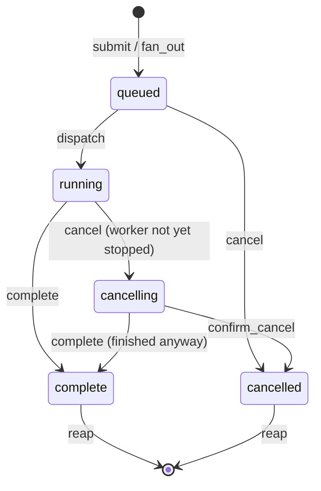
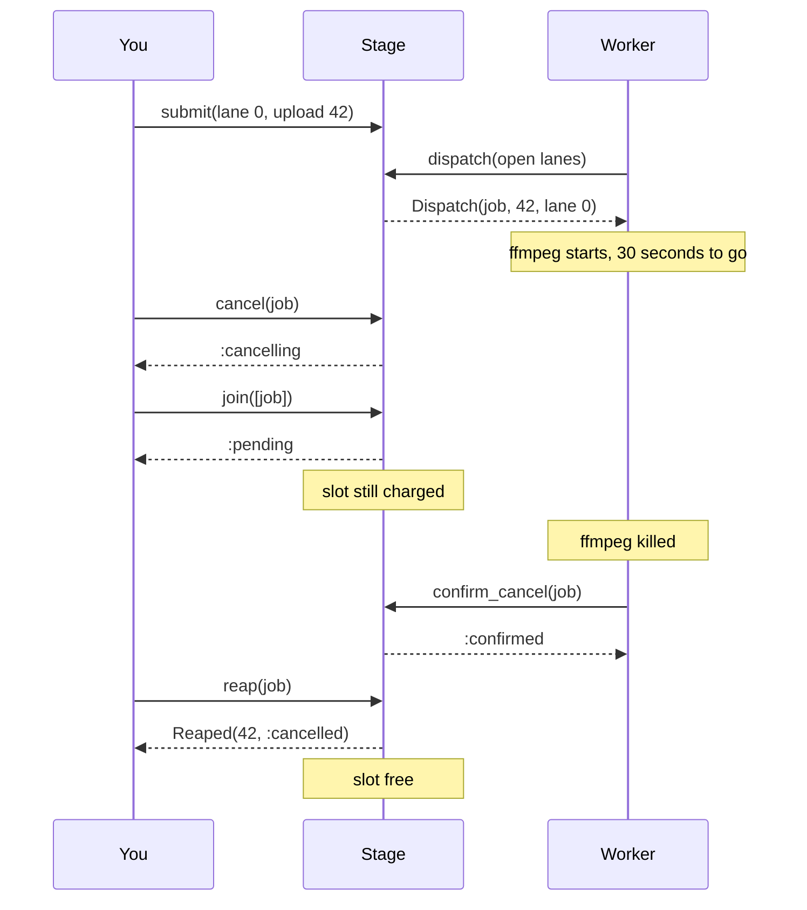

# PipelineMachines

> A job you cancelled is still on the ship until someone signs for it. 🛤️

A stage coordinator for Ruby. You submit work into one of four weighted lanes, pull it out in fair order, report what happened, and collect the receipt. Fan a job out across several lanes and join on all of them. The stage keeps count of every slot, including the ones holding work you told to stop but that hasn't stopped yet.

## Quick Start

```bash
gem 'pipeline_machines'
```

```ruby
# Four lanes: transcode, thumbnail, captions, notify. Thumbnails get double share.
stage = PipelineMachines::Stage.new([1, 2, 1, 1])

# One upload, three lanes at once. All three are admitted, or none is.
jobs = stage.fan_out([0, 1, 2], upload.id)   # => [1, 2, 3], job ids

# The worker loop. You say which lanes may run; dispatch hands back a Dispatch.
open_lanes = [true, true, true, true]
while (work = stage.dispatch(open_lanes))
  run_lane(work.lane, work.payload)
  stage.complete(work.id)                    # => :completed
end

stage.join(jobs)                     # => :ready
jobs.each { |job| stage.reap(job) }  # collect receipts, free the slots
```

Job ids are Integers. Every call answers with a value: what it did, or a symbol naming why it did nothing.

## A Message to the Resistance

So you built the upload pipeline. A job comes in, you push three tasks onto a queue, three workers pick them up, the video gets transcoded, thumbnailed, and captioned. Then product asked for cancel.

You added a `cancelled` flag. Workers check it before starting. Great. Except the transcode worker checked it four seconds ago and is now thirty seconds into an ffmpeg call that doesn't care about your flag. The user sees "cancelled", uploads a replacement, and now two transcodes of the same video are fighting over one CPU. Meanwhile your concurrency limit says there's a free slot, because the cancelled job was removed from the queue the moment the flag flipped.

The queue was honest about what was *waiting*. It lied about what was *running*. A slot isn't free when you decide a job should stop. It's free when the job has actually stopped and you've collected the outcome.

This gem keeps that count. Queued work can be cancelled outright. Running work stays on the books until the worker confirms it quit, or finishes anyway. Nothing frees a slot except reaping the receipt.

## Chapter 1: Stardate 2025.186, the AMS Welsh

> **AMS Welsh**, NCC-4212, *Welsh*-class stage carrier.
> Freight is not gone merely because it left the waiting deck.

The carrier doesn't run any of the work. It holds the manifest: which berths are charged, which descriptors are on the waiting deck, which are on the work deck, and which outcomes are still unsigned. A berth stays charged until the receipt is collected. Not when the job is dispatched, not when it's cancelled. Collected.

Somewhere on the bridge, a junior officer proposes:

```ruby
def cancel(job)
  queue.delete(job)
  job.update(status: :cancelled)   # the worker will notice. probably.
end
```

"That," says the deck officer, "is how a berth gets charged twice."

## The Flight Plan

Every job is in exactly one of these states. Only reaping frees its slot.



And the upload that got cancelled mid-transcode:



## How the Deck Works

### Submit and dispatch

Lanes are numbered 0 to 3. Each lane has a weight you choose at construction. Dispatch walks the lanes you mark eligible in weighted round robin, first in first out within a lane.

```ruby
stage = PipelineMachines::Stage.new([1, 2, 1, 1])
stage.lanes      # => 4
stage.capacity   # => 64

stage.submit(0, 100)   # => 1, the job id
stage.submit(0, 101)   # => 2
stage.submit(1, 200)   # => 3
stage.submit(1, 201)   # => 4
stage.submit(2, 300)   # => 5

work = stage.dispatch([true, true, true, true])
work   # => #<data PipelineMachines::Dispatch id=1, payload=100, lane=0>
```

Lane 1 has weight 2, so it gets two turns per round. With the queue above, dispatch order is lane 0, lane 1, lane 1, lane 2, then lane 0 again. Payloads are Integers: ids, pointers into your own tables, whatever names the work. The stage never sees the work itself.

`dispatch` takes one `true` or `false` per lane. That's where your own policy goes: a lane whose workers are all busy, whose downstream is pushing back, or whose deadline hasn't come is `false` this round, and the scheduler skips it without losing its place.

```ruby
stage.dispatch([false, false, true, true]).lane   # => 2, lanes 0 and 1 held back
stage.dispatch([false, false, false, false])      # => nil
```

`dispatch` answers `nil` when no eligible lane has a queued job. That's an answer, not a refusal.

A lane that doesn't exist is `:unknown_lane` from `submit`, and a full stage is `:full`. It never raises for that.

### Fan out and join

One payload, several lanes, admitted atomically. Either every lane gets a job or none does: a fan-out that would be short one slot, one id, or one valid lane admits nothing at all.

```ruby
stage = PipelineMachines::Stage.new([1, 1, 1, 1])
jobs = stage.fan_out([3, 1], 9)   # => [1, 2], ids in the order you named the lanes
stage.join(jobs)                  # => :pending

2.times do
  work = stage.dispatch([true, true, true, true])
  stage.complete(work.id)
end
stage.join(jobs)                  # => :ready

stage.fan_out([0, 0], 9)          # => :repeated_lane
stage.fan_out([0, 4], 9)          # => :unknown_lane
```

`join` answers for the whole group. `:ready` when every job completed, `:cancelled` when any was cancelled, `:pending` while any is still queued, running, or waiting on a cancel confirmation. If any id names no job the stage holds, because it was reaped or belongs to another stage, `join` refuses with `:stale`: it only answers for jobs still on the manifest.

### Cancel, and what cancel actually means

Cancel a queued job and it's done. Terminal. Reap it whenever you like.

```ruby
stage = PipelineMachines::Stage.new([1, 1, 1, 1])
job = stage.submit(2, 77)

stage.cancel(job)     # => :cancelled
stage.join([job])     # => :cancelled
stage.reap(job)       # => #<data PipelineMachines::Reaped payload=77, terminal=:cancelled>
stage.dispatch([true, true, true, true])   # => nil, nothing left
```

Cancel a *running* job and you've only asked. The slot stays charged until the worker says it stopped.

```ruby
stage = PipelineMachines::Stage.new([1, 1, 1, 1])
stage.submit(0, 5)
job = stage.dispatch([true, true, true, true]).id

stage.cancel(job)           # => :cancelling, request noted
stage.cancel(job)           # => :already_cancelling, you asked already
stage.reap(job)             # => :not_terminal
stage.join([job])           # => :pending

stage.confirm_cancel(job)   # => :confirmed, worker has stopped
stage.reap(job).terminal    # => :cancelled
```

If the worker finishes before it sees the request, `complete` wins and the cancel is moot:

```ruby
stage = PipelineMachines::Stage.new([1, 1, 1, 1])
stage.submit(0, 1)
job = stage.dispatch([true, true, true, true]).id

stage.cancel(job)           # => :cancelling
stage.complete(job)         # => :completed, it finished anyway
stage.confirm_cancel(job)   # => :concluded, it ended the other way
stage.reap(job).terminal    # => :complete
```

### Saying it twice

Workers retry. A message is delivered twice, a rescue block reports what the ensure block already reported. While the job is still on the manifest the stage can see that what you're asking for already happened, so it says so and changes nothing:

```ruby
stage.complete(job)         # => :completed
stage.complete(job)         # => :already_complete
stage.cancel(queued)        # => :cancelled
stage.cancel(queued)        # => :already_cancelled
stage.confirm_cancel(queued) # => :already_cancelled
```

What it won't do is pretend the opposite happened. `complete` on a cancelled job and `cancel` on a completed one are `:concluded`. And once you reap, the receipt is gone: the stage keeps no history, so a second `reap` is `:stale`, the same as an id it never issued.

### Reap, or the slot never comes back

The stage holds 64 jobs. Not 64 queued, not 64 running. 64 *unreaped*. A completed job you never reap is a slot you never get back.

```ruby
stage = PipelineMachines::Stage.new([1, 1, 1, 1])
jobs = 64.times.map { |i| stage.submit(0, i) }
stage.submit(0, 65)         # => :full

job = stage.dispatch([true, true, true, true]).id
stage.complete(job)
stage.submit(0, 65)         # => :full, still. complete isn't reap.

stage.reap(job)             # => #<data PipelineMachines::Reaped payload=0, terminal=:complete>
stage.submit(0, 65)         # => 65, admitted
stage.size                  # => 64
```

`reap` only takes terminal jobs and hands back a `Reaped`: the payload and `:complete` or `:cancelled`. A job that is still queued, running, or cancelling is `:not_terminal`. After reaping, the id is dead: every call with it answers `:stale`, and `state` answers `nil`.

### Drain

Shutting down a worker pool means two things: stop taking work, and know when the last job is gone.

```ruby
stage = PipelineMachines::Stage.new([1, 1, 1, 1])
job = stage.submit(0, 5)

stage.begin_drain           # => :begun
stage.begin_drain           # => :already_draining
stage.submit(0, 6)          # => :draining, closed
stage.drained?              # => false, one job still charged

work = stage.dispatch([true, true, true, true])   # draining still dispatches what's queued
stage.complete(work.id)
stage.drained?              # => false, completed but not reaped
stage.reap(job)
stage.drained?              # => true
```

### Scopes

A job id is only meaningful to the stage that issued it. Ids are plain Integers, so two stages left alone issue the same ones. Run more than one stage and give each its own scope, an Integer in `0..65535` that rides in the top 16 bits of every id:

```ruby
transcode = PipelineMachines::Stage.with_scope([1, 1, 1, 1], 1)
publish   = PipelineMachines::Stage.with_scope([1, 1, 1, 1], 2)

job = transcode.submit(0, 42)
PipelineMachines.scope_of(job)   # => 1
publish.cancel(job)              # => :stale, not one of mine
publish.state(job)               # => nil
transcode.cancel(job)            # => :cancelled
```

`Stage.new` is scope zero and counts 1, 2, 3. The stage can't pick a scope for you: it reads no clock and rolls no dice.

A restarted stage counts from one again, so an id that outlived the restart could name a new job. Resume from a saved count with `Stage.resumed(weights, scope, stage.issued)`, or give each incarnation a new scope. `resumed` brings back the id sequence and nothing else: the stage is empty, earlier ids are `:stale`, and an `issued` above 2**48-1 raises `RangeError`.

### What each call answers

| Call | Honoured | Records the clock | Refused, nothing changed |
| --- | --- | --- | --- |
| `submit(lane, payload)` | the job id (Integer) | no clock | `:draining`, `:unknown_lane`, `:full`, `:exhausted` |
| `fan_out(lanes, payload)` | the job ids in lane order (Array), `[]` for no lanes | no clock | `:draining`, `:unknown_lane`, `:repeated_lane`, `:full`, `:exhausted` |
| `dispatch(eligible)` | a `Dispatch`, or `nil` when no eligible lane has a queued job | no clock | never refuses |
| `cancel(id)` | `:cancelled` (was queued), `:cancelling` (is running), `:already_cancelling`, `:already_cancelled` | no clock | `:stale`, `:concluded` |
| `complete(id)` | `:completed`, `:already_complete` | no clock | `:stale`, `:not_running`, `:concluded` |
| `confirm_cancel(id)` | `:confirmed`, `:already_cancelled` | no clock | `:stale`, `:not_cancelling`, `:concluded` |
| `reap(id)` | a `Reaped` | no clock | `:stale`, `:not_terminal` |
| `join(ids)` | `:ready`, `:pending`, `:cancelled` | no clock | `:stale` |
| `begin_drain` | `:begun`, `:already_draining` | no clock | never refuses |
| `state(id)` | `:queued`, `:running`, `:cancelling`, `:complete`, `:cancelled`, or `nil` for an id that names no held job | no clock | a query, never refuses |
| `size`, `empty?`, `capacity`, `lanes`, `scope`, `issued`, `draining?`, `drained?` | the value | no clock | queries, never refuse |

The `:already_…` answers are repeats: what you asked for already held, and nothing changed. `:exhausted` means this stage has issued all 2**48-1 ids of its scope; none is ever reissued. There is no clock anywhere in the stage, so no answer records one. Every refusal has its own symbol; there is no catch-all. The Rust core has one more, `Undersized`, for a fan-out buffer too short to hold the ids; the gem sizes that buffer itself, so you never see `:undersized`.

## The Rules of the Carrier

- **Four lanes, sixty-four slots.** `Stage::LANES` and `Stage::CAPACITY`, also `stage.lanes` and `stage.capacity`. Weights are an Array of exactly four Integers in `1..2**32-1`: anything else raises `TypeError`, a weight outside the range raises `RangeError`.
- **Lanes, payloads, and job ids are Integers** in `0..2**64-1`. Floats, nil, and strings raise `TypeError`. Negative or too large raises `RangeError`. A lane that fits an Integer but names no lane is `:unknown_lane`.
- **Eligibility is one `true` or `false` per lane.** `dispatch` takes an Array of exactly four. Anything else raises `TypeError`.
- **Refusals don't raise, and don't change anything.** `:draining`, `:unknown_lane`, `:repeated_lane`, `:full`, `:exhausted`, `:stale`, `:not_running`, `:not_cancelling`, `:not_terminal`, and `:concluded` are answers. Not a job, not a slot, not an issued id, not the scheduler moves on a refusal. Only malformed input raises.
- **Fan-out is all lanes or none.** Every reason to refuse any lane is checked before the first job is admitted.
- **Repeats.** A repeated `cancel`, `complete`, `confirm_cancel`, or `begin_drain` is honoured with an `:already_…` answer while the stage can still see the job, and changes nothing. A repeated `reap` is `:stale`: the slot is free and the stage keeps no history of it.
- **Scopes.** Give each stage its own with `Stage.with_scope(weights, scope)`; the core cannot pick one. An id from another scope, or one never issued, is `:stale` before anything is looked up. Two stages in the same scope issue the same ids.
- **Restarts.** Resume from a saved count with `Stage.resumed(weights, scope, issued)`, or give each incarnation a new scope. `resumed` restores the id sequence only; resubmitting is yours.
- **`dispatch` can come back empty.** `nil` means no eligible lane had queued work. The scheduler still notes that the lane it was visiting had nothing, so that lane starts its next burst fresh.
- **A `Dispatch` or `Reaped` is valid or does not exist.** Built by the stage or by you, `with` included, it is checked by the core: `Dispatch.new(0, 1, 0)` (sequence zero is never issued) and `Dispatch.new(1, 1, 4)` (no fifth lane) raise `RangeError`, as does `Reaped.new(1, :nope)`; a non-Integer field or a non-Symbol terminal raises `TypeError`. Both are sealed: `allocate` is gone and subclassing raises `TypeError` (a named `class X < Reaped` still binds its constant first; Ruby does that before `inherited` runs). The stage never reads a value back, ids are plain Integers, so a forged one cannot reach it.
- **The binding never loses work.** Bad arguments raise before the stage is touched. `dispatch` and `reap` answer with values built by Ruby code, so they run on a copy of the stage and the stage moves only once the answer exists: if building it raised, the job is still queued (or still held) and the next call finds it. If a redefined constructor froze the stage while the answer was being built, the call raises `FrozenError`; if it changed the stage, `RuntimeError` and that change stands. Either way the call is not applied. The value classes are resolved once when the gem loads; swapping a constant later changes nothing the stage builds.
- **Frozen means frozen.** `submit`, `fan_out`, `dispatch`, `cancel`, `complete`, `confirm_cancel`, `reap`, and `begin_drain` raise `FrozenError`. The queries and `join` still answer.

## What You Think You're Doing vs Reality

### You Think: "I cancelled it, so the slot is free."
### Reality: You cancelled it, so the slot is spoken for by a job nobody is watching.

Removing work from a queue is instant. Stopping work that has already started is a negotiation with a process that may be deep inside a syscall. Between those two moments the resources are still in use, and any capacity count that says otherwise will admit one job too many, every time, right when the system is under the most pressure.

## What's Yours

The stage counts. It doesn't run, schedule, persist, or time anything out. You run the worker loop and call `dispatch` when you have a free worker. You decide what a payload means. You tell the stage `complete` or `confirm_cancel` when the work really stopped, and you `reap` every job, every time, or the slots drain away. Across a restart, the manifest is gone, so write down what you dispatched before you dispatch it, and save `issued` so the next stage doesn't hand out an old job's id.

## License

MIT License. See [LICENSE.txt](LICENSE.txt) for details.

**Remember: The transcode you cancelled at 14:02 is still burning a core at 14:03. The stage knows. Your queue didn't.**
